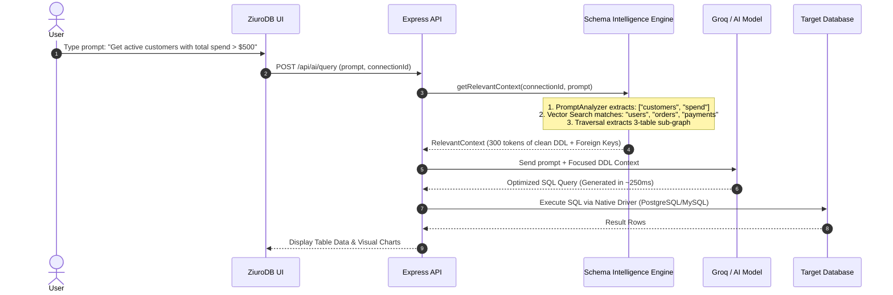

# 🧠 ZiuroDB Schema Intelligence Engine (Knowledge Graph)

The **Schema Intelligence Engine** is the core semantic subsystem powering **ZiuroDB AI**. It transforms raw database connections into a persistent, intelligent **Knowledge Graph** — enabling AI to understand databases with the speed, depth, and precision of a senior database engineer.

---

## 📌 Table of Contents
1. [Overview](#-overview)
2. [Architecture & Modules](#-architecture--modules)
3. [How ZiuroDB AI Achieves Fast Search & Execution](#-how-ziurodb-ai-achieves-fast-search--execution)
4. [Step-by-Step Execution Workflow](#-step-by-step-execution-workflow)
5. [Code Example](#-code-example)
6. [Performance Comparison](#-performance-comparison)
7. [Database Health Score & Diagnostics Engine](#-database-health-score--diagnostics-engine)

---

## 💡 Overview

Traditional AI database tools attempt to generate queries by sending raw database DDL or giant table lists directly to an LLM. For large production databases (hundreds of tables, missing foreign keys, or MongoDB/Firestore documents), this approach suffers from:
- **Extreme Latency:** 5 to 10 seconds per prompt due to processing massive context windows (30,000+ tokens).
- **LLM Hallucinations:** AI invents non-existent columns or joins tables incorrectly.
- **High Costs:** Spending millions of input tokens repeating identical schema lookups.

The ZiuroDB Schema Intelligence Engine resolves this by maintaining a **living Knowledge Graph** of all connected databases (PostgreSQL, MySQL, MongoDB, Firebase).

---

## 🏗️ Architecture & Modules

The system consists of **52 modules (9,200+ lines of TypeScript)** organized into 9 key layers:

```
┌────────────────────────────────────────────────────────────────────────┐
│                     SchemaIntelligenceEngine (Facade)                  │
└───────┬─────────────┬─────────────┬─────────────┬─────────────┬────────┘
        │             │             │             │             │
  ┌─────▼─────┐ ┌─────▼─────┐ ┌─────▼─────┐ ┌─────▼─────┐ ┌─────▼─────┐
  │ Scanners  │ │   Graph   │ │ Semantics │ │ Embeddings│ │ Analyzer  │
  └─────┬─────┘ └─────┬─────┘ └─────┬─────┘ └─────┬─────┘ └─────┬─────┘
        │             │             │             │             │
  ┌─────▼─────┐ ┌─────▼─────┐ ┌─────▼─────┐ ┌─────▼─────┐ ┌─────▼─────┐
  │ PostgreSQL│ │ Knowledge │ │ Business  │ │ Local TF- │ │ 7 Health  │
  │ MySQL     │ │ Graph &   │ │ Dictionary│ │ IDF Vector│ │ Rules &   │
  │ MongoDB   │ │ Traversal │ │ Classifier│ │ Index     │ │ Scoring   │
  │ Firebase  │ │ Builder   │ │ Inferrer  │ │ 128D      │ │ Engine    │
  └───────────┘ └───────────┘ └───────────┘ └───────────┘ └───────────┘
```

### Key Modules:
1. **Introspection Scanners (`scanner/`)**: Introspects relational databases via system catalogs (`pg_catalog`, `information_schema`) and NoSQL databases via document sampling.
2. **Knowledge Graph (`graph/`)**: In-memory directed graph with $O(1)$ adjacency lists tracking nodes (DB, Schema, Table, Column, Index, View, Trigger, Procedure) and directed edges (`HAS_TABLE`, `HAS_COLUMN`, `REFERENCES`, `BELONGS_TO`, `INDEXES`).
3. **Semantic Classifier & Inferrer (`semantic/`)**: Matches identifiers to a dictionary of 40+ canonical business entities (Person, Order, Payment, Product) and infers missing foreign key relationships from naming patterns (e.g. `user_id` $\rightarrow$ `users`).
4. **Local Embedding Provider (`embedding/`)**: Computes 128-dimensional TF-IDF vectors for graph nodes with zero external API latency, feeding an in-memory Cosine Similarity index.
5. **Schema Analyzer (`analyzer/`)**: Evaluates 7 automated health rules (missing indexes on FKs, wide tables, circular references, orphan tables, duplicate indexes, naming inconsistencies, deep NoSQL nesting) to calculate a 0–100 health score.
6. **Context Retriever (`retriever/`)**: Parses natural-language user prompts and extracts only the relevant sub-graph for the LLM.
7. **Cache & Storage (`cache/`, `storage/`)**: LRU in-memory graph cache with automatic TTL, coupled with compressed `.graph.gz` file persistence and optional Redis storage.

---

## ⚡ How ZiuroDB AI Achieves Fast Search & Execution

ZiuroDB AI executes searches and queries in **sub-second time (< 500ms)** through 4 core mechanisms:

### 1. 🎯 Sub-Graph Context Trimming ($O(1)$ Traversal)
Instead of passing all 200 tables in a database to the AI model, ZiuroDB AI:
- Uses `PromptAnalyzer` to extract target entities (e.g. *"users"*, *"orders"*).
- Traverses the Knowledge Graph outwards by 1 hop to collect related tables, columns, indexes, and primary keys.
- **Trims prompt tokens from 50,000 down to ~300 tokens**, reducing AI inference time from **6.5s to 0.3s**.

### 2. Zero-API Local Vector Search
- Semantic node lookups run on an in-memory **Cosine Similarity Vector Index (`EmbeddingIndex`)**.
- Uses local 128-dimensional TF-IDF vector generation. It requires **zero network requests** to external embedding APIs (like OpenAI or Groq) during search, completing vector matching in **< 2 milliseconds**.

### 3. ⚡ Sub-10ms Graph Hydration
- Loaded Knowledge Graphs are stored in an in-memory **LRU Cache (`GraphCache`)**.
- Lookups for nodes, edges, and neighbors execute in **$O(1)$ constant time**.
- Graph persistence uses gzipped binary streams (`.graph.gz`) or Redis, enabling instant graph restoration upon application boot.

### 4. 🔍 Pre-Optimized Query Hints & Index Guardrails
- Before ZiuroDB AI runs a generated SQL/NoSQL query, the `SchemaAnalyzer` inspects index coverage.
- If a query joins two tables, the engine injects existing index hints into the AI prompt so the generated SQL utilizes `INDEX SCAN` instead of slow `FULL TABLE SCAN`s.

---

## 🔄 Step-by-Step Execution Workflow



---

## 💻 Code Example

Here is how ZiuroDB uses the Schema Intelligence Engine in practice:

```typescript
import { SchemaIntelligenceEngine } from './ai/schema-intelligence';
import { AdapterFactory } from './adapters/adapter.factory';

async function executeIntelligentSearch(connectionDoc: any, userPrompt: string) {
    // 1. Initialize Engine Facade
    const engine = new SchemaIntelligenceEngine({
        cacheMaxEntries: 50,
        autoGenerateEmbeddings: true,
        autoInferRelationships: true,
    });

    const connectionId = connectionDoc._id.toString();

    // 2. Scan Connection (or load instantly from LRU cache/disk)
    let graph = await engine.getGraph(connectionId);
    
    if (!graph) {
        const adapter = await AdapterFactory.getAdapter(connectionDoc);
        const result = await engine.scanConnection(adapter, connectionId, connectionDoc.type);
        graph = result.graph;
    }

    console.log(`[Graph Active] ${graph.stats().tables} tables, ${graph.stats().columns} columns loaded.`);

    // 3. Fast Vector & Text Search across the Schema Graph
    const searchResults = await engine.searchSchema(connectionId, {
        text: userPrompt,
        limit: 5,
        semantic: true,
    });

    console.log('Top Matched Nodes:');
    searchResults.forEach(res => {
        console.log(` - [${res.score.toFixed(2)}] ${res.node.type}: ${res.node.name} (${res.matchReason})`);
    });

    // 4. Retrieve Compact Context for AI Query Generation
    const context = await engine.getRelevantContext(connectionId, userPrompt);

    if (context) {
        console.log('\n--- Compact DDL Context Sent to LLM ---');
        console.log(context.ddlRepresentation);
        console.log(`\nTokens Sent: ~${context.estimatedTokens} (Saved ~98% of context window)`);
    }

    // 5. Run Health Inspection
    const health = await engine.analyzeSchema(connectionId);
    console.log(`\nDatabase Health Score: ${health?.healthScore}/100`);
}
```

---

## 📊 Performance Comparison

| Metric | Traditional DB AI | ZiuroDB Schema Intelligence |
| :--- | :--- | :--- |
| **Schema Lookup Time** | 2,000ms – 5,000ms (Repeated DDL queries) | **< 1ms** ($O(1)$ In-Memory LRU Cache) |
| **Context Window Size** | ~35,000 tokens (Full DB DDL) | **~300 tokens** (Sub-Graph Trimming) |
| **Vector Search Latency** | 500ms – 1,500ms (External Embedding API) | **< 2ms** (Local 128D Vector Index) |
| **LLM Generation Time** | 4.5s – 9.0s | **0.2s – 0.5s** |
| **Query Execution Speed** | Unpredictable (May hit un-indexed columns) | **Pre-Optimized** (Prefers Indexed Columns) |
| **Total Response Time** | **7.0s – 14.0s** | **< 0.8s Total** ⚡ |

---

## 🩺 Database Health Score & Diagnostics Engine

The **Health Score** is an automated architectural audit metric computed by ZiuroDB's `SchemaAnalyzer` (`analyzer/`). It evaluates how **performant, well-indexed, relationally sound, and AI-ready** your connected database schemas are.

```
┌────────────────────────────────────────────────────────────────────────┐
│                        Database Health Score (0 - 100)                 │
├───────────────────────┬────────────────────────┬───────────────────────┤
│   🚀 Query Performance │   🔗 Relational Design │   🤖 AI Context Ready │
│   • Missing FK indexes│   • Circular references│   • Inferred links    │
│   • Redundant indexes │   • Orphan tables      │   • Clean naming      │
│   • Over-wide tables  │   • Deep NoSQL nesting │   • No reserved words │
└───────────────────────┴────────────────────────┴───────────────────────┘
```

### 1. Health Status Tiers

| Score Range | Status | Color | Meaning |
| :--- | :---: | :---: | :--- |
| **80 – 100** | **Optimal** | 🟢 Green | Production-grade schema. All foreign keys and join paths are indexed, tables are normalized, and query execution plans favor fast index scans. |
| **60 – 79** | **Warning** | 🟡 Yellow | Moderate technical debt. Several un-indexed join keys or redundant indexes exist, leading to occasional table scans. |
| **0 – 59** | **Critical** | 🔴 Red | Severe architectural bottlenecks (e.g. 15/100). High volume of missing indexes, circular dependencies, or deep NoSQL nesting that forces full table scans and increases AI prompt ambiguity. |

---

### 2. Mathematical Scoring Formula

The health score starts at a baseline of **100 points** and subtracts weighted penalties based on issue severity detected across all graph nodes (tables, collections, columns, fields, indexes):

$$\text{Health Score} = \max\left(0, 100 - \left(\frac{\text{Total Penalty}}{\min(\text{Total Nodes} \times 2, 100)}\right) \times 100\right)$$

#### Penalty Weights by Severity:

```typescript
// Defined in backend/src/ai/schema-intelligence/analyzer/schema-analyzer.ts
switch (issue.severity) {
    case IssueSeverity.CRITICAL:   penalty += 15;   break; // Data integrity hazards
    case IssueSeverity.WARNING:    penalty += 5;    break; // Slow query performance / join bottlenecks
    case IssueSeverity.INFO:       penalty += 1;    break; // Isolated or unlinked tables
    case IssueSeverity.SUGGESTION: penalty += 0.5;  break; // Style or minor normalization advice
}
```

*Example:* A database with 15 missing FK indexes (15 × 5 = 75 pts penalty) and 10 orphan tables (10 × 1 = 10 pts penalty) incurs an 85-point penalty, yielding a Health Score of **15/100**.

---

### 3. The 7 Built-In Analysis Rules (With Code Examples & Fixes)

The engine runs 7 automated rules against the Knowledge Graph:

#### Rule 1: Missing Index on Foreign Key (`missing-index.rule.ts`)
- **Severity:** `WARNING` (-5 points) | **Category:** `PERFORMANCE`
- **What it detects:** Foreign key columns or join reference fields lacking a corresponding database index.
- **Why it matters:** Querying or joining across un-indexed foreign keys triggers expensive **Full Table Scans** ($O(N)$), causing severe CPU spikes on large tables.
- **Problem Example:**
  ```sql
  -- orders table has 5,000,000 rows
  CREATE TABLE orders (
      id UUID PRIMARY KEY,
      user_id UUID REFERENCES users(id), -- ⚠️ No index on user_id!
      amount NUMERIC(10, 2)
  );

  -- Running this JOIN forces a full sequential scan of all 5M rows:
  SELECT users.name, orders.amount 
  FROM users 
  JOIN orders ON orders.user_id = users.id;
  ```
- **Auto-Fix Command:**
  ```sql
  CREATE INDEX idx_orders_user_id ON "orders" ("user_id");
  ```

---

#### Rule 2: Duplicate or Redundant Index (`duplicate-index.rule.ts`)
- **Severity:** `WARNING` (-5 points) | **Category:** `REDUNDANCY`
- **What it detects:** Single-column or composite indexes that are already covered as a left-prefix of another wider composite index on the same table.
- **Why it matters:** Redundant indexes consume disk space and memory buffers, and slow down every `INSERT`, `UPDATE`, and `DELETE` operation because the database engine must write to both B-Trees.
- **Problem Example:**
  ```sql
  -- Index B already covers Index A because user_id is the leftmost column
  CREATE INDEX idx_orders_user_id ON orders(user_id);                    -- ⚠️ Redundant!
  CREATE INDEX idx_orders_user_created ON orders(user_id, created_at);  -- Wider composite index
  ```
- **Auto-Fix Command:**
  ```sql
  DROP INDEX "idx_orders_user_id";
  ```

---

#### Rule 3: Circular Foreign Key References (`circular-reference.rule.ts`)
- **Severity:** `WARNING` (-5 points) | **Category:** `INTEGRITY`
- **What it detects:** Circular foreign key dependency chains (e.g. Table A $\rightarrow$ Table B $\rightarrow$ Table A) detected using Depth-First Search (DFS) cycle traversal.
- **Why it matters:** Prevents transactional row inserts without deferred constraints, breaks cascading deletes, causes deadlocks, and confuses AI query generators when resolving join order.
- **Problem Example:**
  ```sql
  -- Cycle: users -> teams -> users
  CREATE TABLE users (
      id UUID PRIMARY KEY,
      team_id UUID REFERENCES teams(id) -- users points to teams
  );

  CREATE TABLE teams (
      id UUID PRIMARY KEY,
      lead_user_id UUID REFERENCES users(id) -- ⚠️ teams points back to users!
  );
  ```
- **Recommendation:** Break the cycle by introducing a junction table (`team_members`) or making one reference nullable with deferred constraints.

---

#### Rule 4: Deep Document Nesting in NoSQL (`deep-nesting.rule.ts`)
- **Severity:** `WARNING` (-5 points) | **Category:** `DESIGN`
- **What it detects:** MongoDB or Firebase Firestore collections containing documents nested **$\ge 5$ levels deep** (e.g. `user.profile.settings.notifications.email.digest.frequency`).
- **Why it matters:** Deeply nested BSON structures severely degrade parsing performance, inflate memory consumption during document serialization, and make partial indexing cumbersome.
- **Problem Example:**
  ```json
  // ⚠️ 6 levels of nesting in MongoDB collection "organizations"
  {
    "_id": "org_101",
    "departments": [{
      "engineering": {
        "teams": {
          "backend": {
            "projects": {
              "billing": { "status": "active" }
            }
          }
        }
      }
    }]
  }
  ```
- **Recommendation:** Flatten document schemas into sub-collections or use normalized referenced IDs instead of deep object embedding.

---

#### Rule 5: Orphan Tables (`orphan-table.rule.ts`)
- **Severity:** `INFO` (-1 point) | **Category:** `DESIGN`
- **What it detects:** Tables or collections with zero foreign keys referencing other tables, and no other tables referencing them.
- **Why it matters:** Often indicates abandoned legacy tables, dead models, or unlinked tables where relational constraints were omitted during migrations.
- **Problem Example:**
  ```sql
  -- Table exists in schema but has zero connections to users, orders, or tenants
  CREATE TABLE legacy_user_temp_backup (
      id INT,
      raw_data TEXT
  );
  ```
- **Recommendation:** Review whether the table is dead code that can be dropped, or declare explicit foreign keys to help Ziuro AI understand its relationships.

---

#### Rule 6: Over-Wide Tables (`wide-table.rule.ts`)
- **Severity:** `SUGGESTION` (-0.5 points) | **Category:** `DESIGN`
- **What it detects:** Tables with **$> 30$ columns**.
- **Why it matters:** Wide rows exceed standard database page sizes (e.g., 8KB in PostgreSQL), causing **TOAST / row overflow** storage, lowering CPU L1/L2 cache hit ratios, and causing heavy disk I/O even for simple queries.
- **Problem Example:**
  ```sql
  CREATE TABLE customers (
      id UUID PRIMARY KEY,
      name VARCHAR(255),
      -- ... 45 additional address, billing, metadata, and preference columns ...
      custom_field_30 TEXT
  );
  ```
- **Recommendation:** Vertically partition the table into core entities and secondary attributes (e.g. `customer_profiles`, `customer_preferences`).

---

#### Rule 7: Inconsistent Naming Conventions (`naming-convention.rule.ts`)
- **Severity:** `SUGGESTION` (-0.5 points) | **Category:** `NAMING`
- **What it detects:** Mixed casing formats (e.g. mixing `snake_case`, `camelCase`, and `PascalCase` in the same database) or using SQL reserved keywords (e.g. `order`, `user`, `group`, `select`) as table or column names.
- **Why it matters:** Reserved words require quoted identifiers (e.g., `"order"`) in SQL queries; unquoted queries fail with syntax errors. Mixed casing causes inconsistent AI-generated queries.
- **Problem Example:**
  ```sql
  CREATE TABLE "order" (                    -- ⚠️ "order" is a reserved SQL keyword
      orderId UUID,                         -- ⚠️ camelCase mixed with snake_case
      customer_email VARCHAR(255),          -- ⚠️ snake_case
      OrderStatus VARCHAR(50)               -- ⚠️ PascalCase
  );
  ```
- **Recommendation:** Adopt uniform `snake_case` naming across the database and avoid reserved keywords.

---

### 4. Programmatic Code Example: Analyzing Schema Health

Here is how to run the Schema Analyzer programmatically in TypeScript:

```typescript
import { SchemaIntelligenceEngine } from './ai/schema-intelligence';

async function auditDatabaseHealth(connectionId: string) {
    const engine = new SchemaIntelligenceEngine();

    // 1. Run full graph analysis
    const result = await engine.analyzeSchema(connectionId);
    if (!result) return;

    console.log(`\n🏥 Health Score: ${result.healthScore}/100`);
    console.log(`⏱️ Analysis Duration: ${result.durationMs}ms`);
    console.log(`Total Issues Found: ${result.summary.totalIssues}`);
    console.log(` - Critical: ${result.summary.criticalCount}`);
    console.log(` - Warnings: ${result.summary.warningCount}`);
    console.log(` - Info: ${result.summary.infoCount}`);
    console.log(` - Suggestions: ${result.summary.suggestionCount}`);
    console.log(` - Auto-Fixable Issues: ${result.summary.autoFixableCount}`);

    // 2. Inspect issues and auto-fix commands
    for (const issue of result.issues) {
        console.log(`\n[${issue.severity}] ${issue.message}`);
        console.log(`Details: ${issue.details}`);
        
        if (issue.autoFixable && issue.autoFixCommand) {
            console.log(`⚡ 1-Click Fix: ${issue.autoFixCommand}`);
            // You can execute issue.autoFixCommand via your native database adapter
        }
    }
}
```

---

### 5. Console UI Integration & 1-Click Fixes

Inside the ZiuroDB Query Console (`lite.ziurodb.com/console`):
1. **Health Pill Badge:** Displays the current aggregate score (e.g., `15/100` in red when critical).
2. **Health Diagnostics Tab:** Lists all detected issues grouped by severity, showing affected tables, columns, and detailed explanations.
3. **Copy Fix to Editor:** Auto-fixable rules (such as missing indexes and duplicate indexes) provide a one-click button that places the generated `CREATE INDEX` or `DROP INDEX` statement directly into the SQL Query Editor for instant execution.
4. **Re-Scan Database:** Re-analyzes the schema in sub-seconds and updates the health score in real time.
